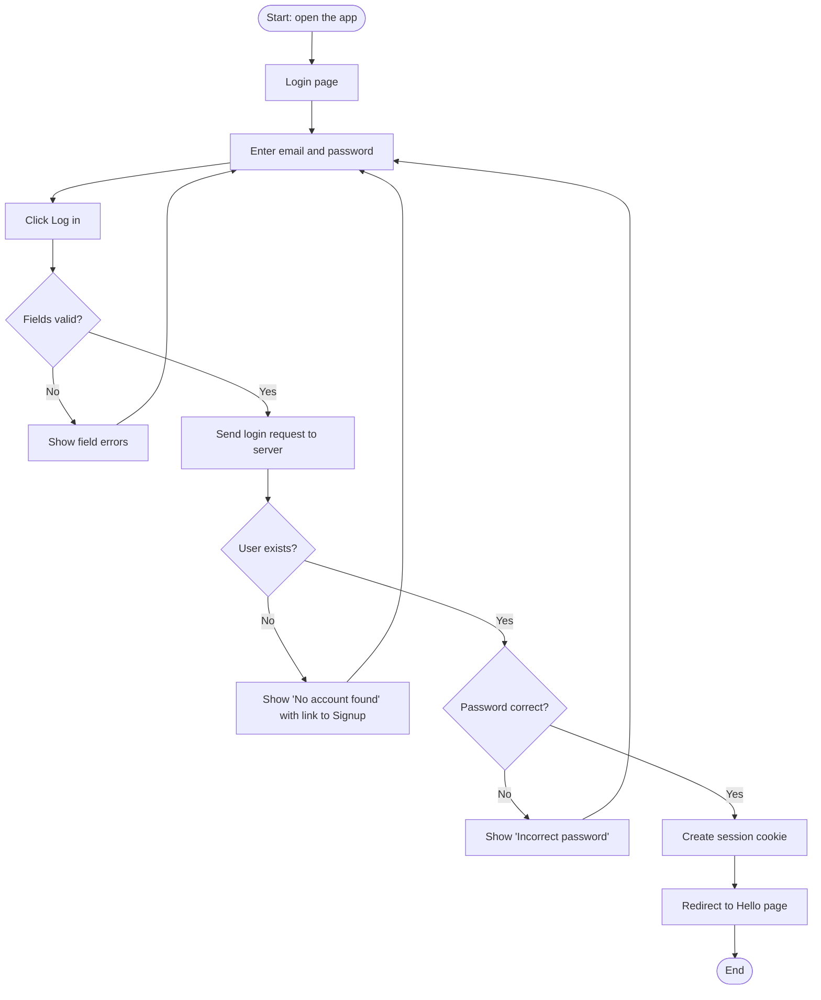
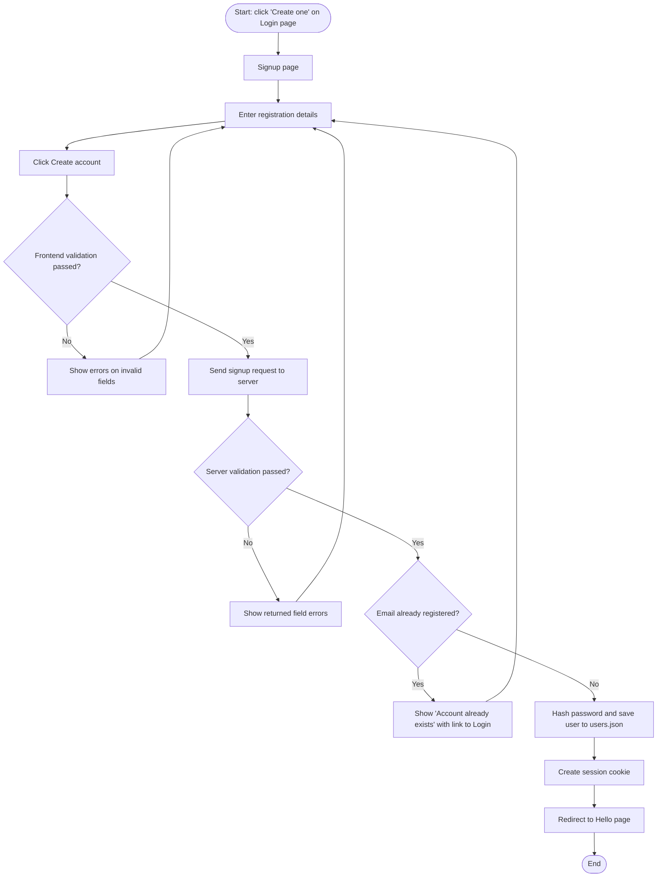

# Xtnd signup and login

A small signup and login app, built twice. In both versions, a Node server saves accounts to `users.json` with hashed passwords.

- **`vanilla/`**: plain HTML, CSS and JavaScript. Run `node server.js` inside `vanilla/`, then open http://localhost:3000.
- **`react/`**: the same app in React (Vite). Inside `react/`, run `npm install` once, then `npm start` (API) and `npm run dev` (app), and open http://localhost:5173.

## Login flow

## Signup flow

