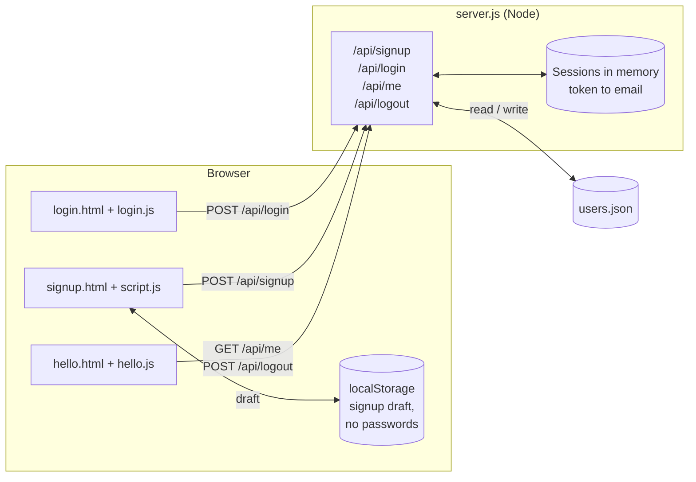
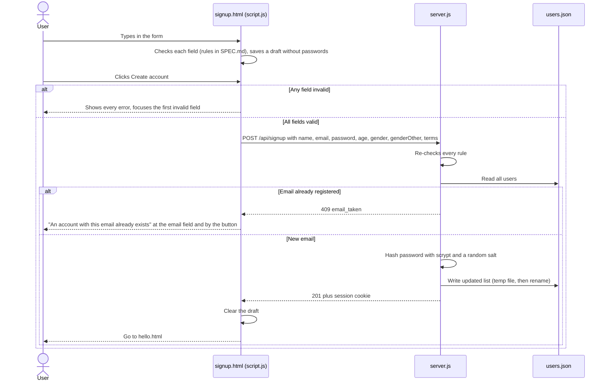
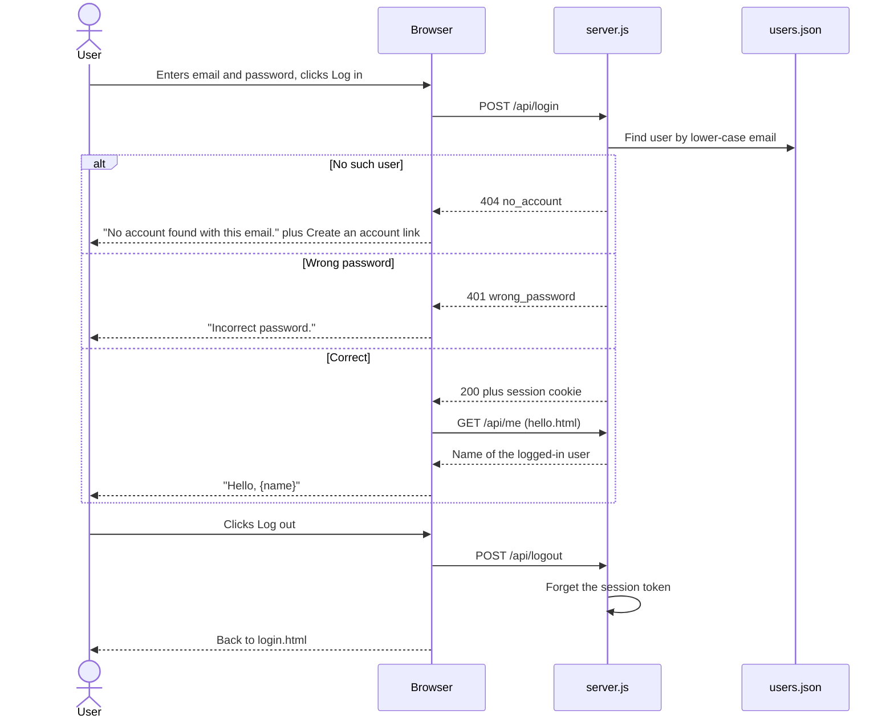

# Xtnd signup and login

Signup and login pages with a small Node server that saves accounts to `users.json`.
After signing up or logging in, the user lands on a page that says "Hello, {name}".

No packages to install: everything uses Node's built-in modules.

## Run it

```sh
npm start        # or: node server.js
```

Open http://localhost:3000 (the login page). Stop the server with **Ctrl+C**.

- Another port: `PORT=3001 npm start`
- "EADDRINUSE: address already in use" means an old server is still running. Find it with `lsof -i :3000`, stop it with `kill <PID>`.

## Project layout

| Path | What it is |
|---|---|
| `server.js` | Entry point. Serves the files in `public/`, handles the `/api/*` routes, reads and writes `users.json`. |
| `public/login.html`, `login.js` | Login page. The start page (`/`). |
| `public/signup.html`, `script.js` | Signup form with live validation and the password checklist. |
| `public/hello.html`, `hello.js` | "Hello, {name}" page with Log out. Only for logged-in users. |
| `public/styles.css` | Shared styles for all pages. |
| `SPEC.md` | Full behaviour spec with Given/When/Then acceptance criteria. |
| `users.json` | Saved accounts. Created on the first signup. Not committed to git. |

## How the pieces fit



## Data flow

### Signup



### Login, hello page and logout



## API

| Route | Body | Responses |
|---|---|---|
| `POST /api/signup` | `name, email, password, age, gender, genderOther, terms` | `201 {name}` with a session cookie · `400 {errors}` with one message per invalid field · `409 email_taken` |
| `POST /api/login` | `email, password` | `200 {name}` with a session cookie · `404 no_account` · `401 wrong_password` |
| `GET /api/me` | — | `200 {name}` · `401` if not logged in |
| `POST /api/logout` | — | `204`, session cleared |

Requests must be JSON and at most 10 KB.

## What's saved in `users.json`

A JSON list with one entry per account:

| Field | Example | Meaning |
|---|---|---|
| `name` | `"Sara Ali"` | Full name, trimmed. Shown on the hello page. |
| `email` | `"sara@example.com"` | Login email, trimmed and lower-cased so capitals don't create a second account. |
| `age` | `30` | Whole number, 18–120. |
| `gender` | `"other"` | `"male"`, `"female"`, `"other"`, `"prefer-not-to-say"`, or `""` if left blank. |
| `genderOther` | `"Non-binary"` | The "Describe your gender" text. Only kept when `gender` is `"other"`. |
| `salt` | `"bab141a0…"` | Random value for this user, mixed into the password before hashing. |
| `passwordHash` | `"940d5285…"` | scrypt hash of the password plus salt. The password itself is never stored. |
| `createdAt` | `"2026-10-08T13:11:01.444Z"` | When the account was created (UTC). |

Confirm password is checked in the browser only. Terms must be accepted, but isn't stored.

## Decisions

Each decision and the reason behind it. The full behaviour rules are in `SPEC.md`.

### Building it

| Decision | Why |
|---|---|
| Plain HTML, CSS and JavaScript, no framework or build step | A few small pages don't need React or a bundler. Easy to read and change. |
| Node server using only built-in modules | Nothing to install; `npm start` just works. |
| Accounts in a `users.json` file instead of a database | You can open the file and see exactly what's saved. Fine for one person running it locally. Not meant for many users at once. |
| Pages live in `public/`, and the server only serves that folder | `users.json` and `server.js` can never be downloaded from the browser. |
| `users.json` is written to a temp file and then renamed | A crash in the middle of saving can't leave a half-written file. |
| `users.json` is in `.gitignore` | It holds real emails and password hashes. |

### Security

| Decision | Why |
|---|---|
| Passwords hashed with scrypt and a random salt per user | Even someone who reads `users.json` can't get the passwords back, and identical passwords produce different hashes. |
| Hashes compared with `timingSafeEqual` | Response time doesn't reveal how close a guess was. |
| Logins use a random token in an `HttpOnly`, `SameSite=Lax` cookie | Page scripts can't read the token, and other sites can't trigger logged-in requests. |
| Sessions kept in memory | Simple. The trade-off: restarting the server logs everyone out. |
| The server re-checks every signup rule | The browser checks can be skipped by sending requests directly, so the server doesn't trust them. |
| Login says "No account found" or "Incorrect password" separately | Clearer for users, which you asked for. The trade-off: someone can find out whether an email is registered. Signup's duplicate-email error reveals that anyway. |

### Form behaviour

| Decision | Why |
|---|---|
| Errors appear when you leave a field, then update as you type | No red errors while you're still typing for the first time, and fixes are confirmed right away. |
| Create account can always be clicked | A greyed-out button doesn't say what's wrong. Clicking shows every error and moves to the first one. |
| Strict password rules (8+ characters, upper, lower, number, symbol), shown as a live checklist | The checklist shows exactly what's missing, so strict rules don't frustrate. |
| Age is a text box with a number keypad, not a number-only box | A number-only box blocks typing letters, so the "Age must be a whole number" error could never appear. |
| Gender is optional, and "Other" reveals an optional "Describe your gender" box (up to 50 characters) | Respects people who don't fit the listed options without forcing anyone to answer. Text is kept if you switch away and back. |
| The signup draft is saved in the browser, but passwords never are | A reload doesn't lose your typing, and passwords stay out of storage. |
| Duplicate email: error at the field and next to the button, with a "log in instead" link | The field is at the top of a long form, so an error only there was easy to miss. |
| Emails compared without regard to capitals or surrounding spaces | "Sara@Example.com " and "sara@example.com" are the same person. |

### Design

| Decision | Why |
|---|---|
| Navy brand panel beside a white form, with an engraved-style serif for headings | A calm, trustworthy look for a bookkeeping product. |
| The decorative line pattern on the brand panel was removed | It was distracting. |
| The form is centred in its area, with text left-aligned | Even spacing on wide screens. Left-aligned labels and errors are easier to scan. |
| Dark mode follows the system setting | Comfortable to use at night with no extra controls. |

## Out of scope

Email verification, password reset, changing account details, social login, CAPTCHA, login attempt limits, "remember me", a Terms page, and hosting anywhere other than your own computer.
